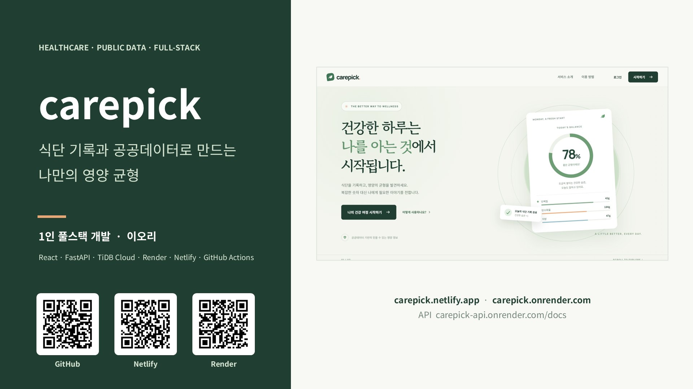

# carepick

> 식단 기록과 공공데이터로 나에게 맞는 영양 목표를 보여 주는 헬스케어 웹 서비스 — 1인 풀스택 개발 **이오리**

## 포트폴리오 사이트 바로가기

### [https://fsclass-n.github.io/carepick/](https://fsclass-n.github.io/carepick/)

10분 발표·시연 영상과 3분 하이라이트를 썸네일 자리에서 바로 재생할 수 있습니다. 영양 목표 계산기와 일반/관리자 권한 비교도 직접 체험할 수 있습니다.

## 작품 안내

| 구분 | 내용 | 바로가기 |
| --- | --- | --- |
| 온라인 발표 · 10분 시연 | PPT 발표 → 운영 사이트에서 일반 사용자·관리자 테스트 계정 비교 → 회고 | [사이트에서 보기](https://fsclass-n.github.io/carepick/#theater) · [MP4](docs/video/carepick_final.mp4) |
| 3분 하이라이트 | 두 테스트 계정의 차이(권한 변경 · 서버 거부 · 역할 비교)만 요약 | [MP4](docs/video/carepick_highlight_3min.mp4) |
| 라이브 서비스 | 로그인 화면의 **일반 사용자 / 관리자** 테스트 계정 버튼으로 바로 체험 | [carepick.onrender.com](https://carepick.onrender.com) |
| API 문서 | FastAPI Swagger | [carepick-api.onrender.com/docs](https://carepick-api.onrender.com/docs) |
| 발표 자료 | 16장 PDF · PPTX | [PDF](docs/pdf/프로젝트_발표자료.pdf) · [PPTX](docs/프로젝트_발표자료.pptx) |

**기술 스택** React 19 · Vite · Tailwind v4 / FastAPI · SQLAlchemy 2 · Argon2 · JWT / TiDB Cloud / Render(Docker) · Netlify · GitHub Actions / 공공데이터포털 식품영양성분DB API

**문서** [실행 및 배포 가이드](docs/산출물/실행_및_배포_가이드.md) · [서비스 설계서](docs/산출물/서비스_설계서.md) · [개발 기록](docs/md/2026-11-16_개발기록.md) · [영상 대본·연출 가이드](docs/video/영상_대본_및_연출가이드.md)

> 영상 내레이션은 AI 합성 음성입니다. 영양 목표는 추정치이며 의료 진단을 대신하지 않습니다.
